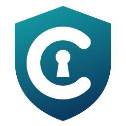

<p align="center"></p>

# CeeSafe

**Memory-safe systems programming, compiled to C.**

CeeSafe is a systems programming language with C#-, Java- and TypeScript-style syntax and Rust-style ownership and
borrowing.
`ceesafec` compiles it ahead of time to portable, readable C11, so a CeeSafe program runs wherever a C compiler does:
Linux, macOS and Windows, bare metal, and inside an operating system kernel. There is no garbage collector and no
reference counting; values are destroyed deterministically. The compiler is written in CeeSafe and rebuilds itself to
the same bytes.

[Documentation](https://vkuttyp.github.io/CeeSafe/) ·
[Getting started](guide/getting-started.md) ·
[Specification](spec/) ·
[Releases](https://github.com/vkuttyp/CeeSafe/releases) ·
[Performance](guide/performance.md)

```ceesafe
struct Account {
    id: u64;
    balance: i64;

    public fn deposit(borrow mut this, amount: i64) {
        this.balance += amount;
    }

    drop {
        Console.write("closing account ");
        Console.writeLine(this.id);
    }
}

fn main() {
    var account = Account { id: 7, balance: 0 };
    account.deposit(100);
    Console.writeLine(account.balance);
}
```

```text
100
closing account 7
```

## Why CeeSafe

In safe code (everything outside an `unsafe` block), CeeSafe rules out:

- **use after free and double free:** every value has one owner and is destroyed exactly once;
- **dangling references:** a reference cannot outlive what it refers to, checked without lifetime annotations in most
  code;
- **conflicting access:** while something is borrowed it cannot be changed, and while it is borrowed mutably nothing
  else can read it;
- **out-of-bounds access and uninitialised reads:** indexes are checked, and variables must be assigned before use;
- **silent integer overflow:** overflow stops the program in every build; wrapping is written explicitly
  (`x.wrappingAdd(y)`).

And beyond safety:

- **Explicit, pluggable allocation.** Each allocation chooses its allocator: the system heap, an arena, a pool, a fixed
  buffer, a scratch frame, or your own. Allocation failure is a value, `Result<T, AllocError>`, handled or propagated
  with `?`. A box that cannot escape its function is placed on the stack.
- **C you can read.** Structured, warning-clean C11 for clang, gcc and MSVC, with `#line` maps back to CeeSafe source
  for lldb and gdb, and a reference interpreter that runs the same programs.
- **Ready for kernels.** A freestanding profile with no C library, context effects that reject sleeping under a spin
  lock, imported C structs, lock guards and kernel objects.
- **The compiler shows its work.** `--explain-allocations`, `--explain-bounds-checks` and `--explain-overflow-checks`
  say which boxes went on the stack and which checks were removed, and why.
- **Tools included.** A formatter, a documentation generator, packages with git dependencies, a language server and
  VS Code extension, debugger scripts, and an MCP server for AI coding agents.

## Performance

With every safety check on, CeeSafe runs sixteen benchmark workloads in **0.96× Rust's time** (geometric mean), and
**0.88×** that of Rust built with overflow checks. Hand-written C without checks takes 0.94×. Binaries are about
40–56 KiB. See [guide/performance.md](guide/performance.md) for the full table, where CeeSafe is ahead or behind and
why, and `benchmarks/` to run it yourself.

## Install

On macOS and Linux:

```sh
curl -fsSL https://vkuttyp.github.io/CeeSafe/install.sh | sh
```

On Windows, in PowerShell:

```powershell
irm https://vkuttyp.github.io/CeeSafe/install.ps1 | iex
```

The script installs the latest release into `~/.ceesafe/bin` after checking its SHA-256. Releases are built for macOS
(arm64 and x64, signed and notarized), Linux (x64 and arm64, glibc 2.35 or newer) and Windows (x64 and arm64).
`ceesafec` is one executable with its runtime, libraries and specification inside; to build programs it needs a C
compiler (clang, gcc or MSVC). Details: [guide/installation.md](guide/installation.md).

## Quick start

```sh
ceesafec new hello        # a package: ceesafe.toml, src/main.cee, AGENTS.md
cd hello
ceesafec check            # type and borrow checks only: the fastest way to find errors
ceesafec build            # compiles to C, then to out/hello
./out/hello
ceesafec run --interp     # runs the program in the reference interpreter
ceesafec fmt              # formats the sources in the one canonical style
```

Other commands: `ceesafec fix` applies the compiler's sure fixes, `ceesafec explain N0249` explains a diagnostic,
`ceesafec doc` writes API documentation, `ceesafec build --emit c` keeps the generated C, and `ceesafec lsp` and
`ceesafec mcp` serve editors and AI agents. `ceesafec` without arguments lists them all.

## Learn more

| | |
|---|---|
| [The guide](guide/) | the language from basics to ownership, memory, collections, generics, closures, threads, `unsafe` and kernel code; [coming from Rust, Zig, C, C#, Go](guide/coming-from/) |
| [The specification](spec/) | the normative rules: grammar, type system, ownership, lifetimes, memory model, the C backend, diagnostics, tooling |
| [For AI agents](guide/for-agents.md) | how an agent should write and check CeeSafe; `ceesafec new --agent claude` sets one up |
| [Editors](guide/editors.md), [debugging](guide/debugging.md) | the [VS Code extension](https://marketplace.visualstudio.com/items?itemName=ceesafe.ceesafe-language) (`code --install-extension ceesafe.ceesafe-language`) and the language server; lldb and gdb |

## Building from source

`ceesafec` is written in CeeSafe. The first build of a checkout starts from novac 0.6.0, the release of Nova that
CeeSafe forked from (see [installation](guide/installation.md#build-from-source)):

```sh
git clone https://github.com/vkuttyp/CeeSafe.git
cd CeeSafe
sh tools/bootstrap.sh ~/.nova/0.6.0/bin/novac HEAD out/ceesafec
out/ceesafec build -o out/ceesafec.new && mv out/ceesafec.new out/ceesafec   # it rebuilds itself from then on
```

Check a change with the contract suite (the fixed point, the corpus under `-Werror` and ASan+UBSan with leak checks,
the allocation-failure sweeps, the mutation suite, the specification and guide):

```sh
python3 tools/contract_tests.py --ceesafec out/ceesafec
```

## Repository layout

| Path | What |
|---|---|
| `src/` | the compiler, in CeeSafe: `syntax/` (lexer, parser), `check/` and `types/` (type and borrow checking), `hir/`, `nir/`, `backend/` (C), `interpreter/`, `formatting/`, `tooling/` (lsp, mcp), `packages/`, `support/` |
| `runtime/` | the C runtime every program links (`ceesafe/rt.h`, `ceesafe_rt_*.c`), embedded by `tools/gen_runtime.py` |
| `spec/`, `guide/` | the specification and the guide, embedded in `ceesafec` and published on the site |
| `tests/reference/` | the corpus: parse, check, run, C-snapshot and optimisation tests with their expectations |
| `tests/support/` | the support library's tests against independent oracles |
| `benchmarks/` | CeeSafe against Rust and C |
| `tools/` | the test runners, generators and the bootstrap |
| `editors/` | the VS Code extension and debugger scripts |
| `integrations/cosmoos/` | building CosmoOS's kernel components with `ceesafec` |
| `docs/decisions/` | CeeSafe's decisions; the language's are in `spec/decisions/` |
| `ROADMAP.md` | scope, phases and the record of work done |

Contributors and AI agents: read [AGENTS.md](AGENTS.md) first.

## History

CeeSafe began as a port of [Nova](https://github.com/vkuttyp/Nova)'s C# compiler to Nova itself, under a new name.
The port reached a verified fixed point and byte-for-byte parity with novac 0.6.0, then forked
([docs/fork-point.md](docs/fork-point.md)). Since [Decision 0007](docs/decisions/0007-runtime-and-first-c-divergence.md)
CeeSafe is developed on its own: its runtime, specification and tests are its own, and nothing is compared with Nova
any more.

## License

CeeSafe is licensed under the GNU General Public License, version 2 only ([COPYING](COPYING)). The runtime and the
library code that `ceesafec` puts into every program it compiles carry an exception
([COPYING.RUNTIME](COPYING.RUNTIME)), so compiling a program with CeeSafe does not by itself place that program under
the GPL.
